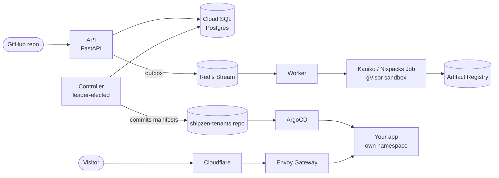

<div align="center">

# ShipZen

**A self-hosted, Heroku-style platform on Google Kubernetes Engine.**

Point it at a GitHub repository. ShipZen builds a container, runs it in its own isolated
namespace and gives it an HTTPS URL, with live build logs, blue-green releases,
instant rollback, per-app secrets and monitoring.

[](https://github.com/jeneeldumasia/ShipZen-GCP/actions/workflows/tests.yaml)
[](https://github.com/jeneeldumasia/ShipZen-GCP/actions/workflows/security-scan.yaml)


[Live instance](https://shipzen.jeneeldumasia.codes) · [Using ShipZen](docs/using-shipzen.md) · [Architecture](docs/architecture.md) · [Security](docs/security.md) · [Runbook](docs/operations/runbook.md)

</div>

---

## Why ShipZen

Platforms like Heroku, Render and Vercel hide a lot of infrastructure behind a
`git push`. ShipZen is that infrastructure, built in the open on Kubernetes: a
multi-tenant internal developer platform where every layer (build, queue, GitOps,
networking, secrets, observability, cost control) is code in this repository.

> Sign-in on the live instance is limited to an allowlist.

## Features

| | |
|---|---|
| 🔨 **Builds anything** | A `Dockerfile` is built with Kaniko. Without one, Nixpacks detects Node, Python, Go and more, writes a Dockerfile, and Kaniko builds it inside a gVisor sandbox. |
| 🧱 **Isolated tenants** | Each project gets its own namespace with resource quotas, restricted Pod Security, NetworkPolicies (GKE Dataplane V2) and its own RBAC. |
| 🔁 **GitOps delivery** | Postgres holds the desired state. The controller renders it into manifests in a Git repo, and ArgoCD applies them, so every change to a running app is a commit. |
| 🟢 **Blue-green and rollback** | Every deploy is a new release that has to pass readiness checks before traffic switches. Rolling back inside the grace window is instant. |
| 📬 **Reliable queue** | A transactional outbox feeds Redis Streams consumer groups, with retries and a dead-letter queue, so a deploy is never queued without being recorded. |
| 🔐 **No long-lived credentials** | CI uses Workload Identity Federation, pods use GKE Workload Identity, Git access goes through a GitHub App, and secrets come from Secret Manager via External Secrets. |
| 👀 **Pull-request previews** | PRs can get their own preview deployment, and a push to the tracked branch deploys automatically. |
| 📊 **Readable monitoring** | Grafana dashboards generated from code, logs per app (Loki), and alerts to Telegram. |
| 💸 **Costs nothing when idle** | Everything is Terraform. The cluster tears itself down when unused ($0 while down) and rebuilds in about 20 minutes. |

## Architecture



**A deploy, step by step:** the UI calls the API → the API writes the deployment and
an outbox row in one transaction → the outbox relay pushes it to Redis → a worker runs
a build Job and pushes the image → the controller commits the release's manifests to
Git → ArgoCD syncs them → once the pods are ready, traffic switches to the new release.

States: `Queued → Building → Deploying → Verifying → Running`, plus `Retry`, `Failed`
and a dead-letter queue. The full picture is in [docs/architecture.md](docs/architecture.md).

## Tech stack

| Layer | Technology |
|---|---|
| Services | FastAPI (API), Python (worker, controller), Next.js 16 + NextAuth (UI) |
| Runtime | GKE (Dataplane V2), Envoy Gateway (Gateway API), Cloudflare |
| Build | Kaniko, Nixpacks, gVisor |
| Data | Cloud SQL Postgres, Redis Streams, GCS, Artifact Registry, Secret Manager |
| Delivery | GitHub Actions, Terraform + HCP Terraform, ArgoCD |
| Platform | External Secrets, Kyverno, ExternalDNS, KEDA, Velero |
| Observability | Prometheus, Grafana, Loki, Alertmanager |

## Repository layout

```text
api/               FastAPI service: auth, projects, deployments, webhooks, admin
  migrations/      numbered SQL migrations, applied at startup
worker/            queue consumer + build Job builder (Kaniko / Nixpacks)
controller/        reconciler: Postgres → Jinja2 manifests → tenants Git repo
  templates/       per-tenant Kubernetes manifests
shipzen_common/    code shared by the services (GitHub App, hostnames, notifications)
ui/                Next.js dashboard
infra/             platform Kubernetes manifests, synced by ArgoCD
terraform/         GKE, Cloud SQL, Redis, ArgoCD, operators, monitoring
terraform-devbox/  optional remote development VM
observability/     generator for the Grafana dashboards
scripts/           operational helpers (verification, cleanup, snapshots)
tests/             pytest suite (unit, API contract, security regressions)
docs/              user guide, architecture, security, operations runbooks
.github/workflows/ CI, image builds, infrastructure deploy/destroy
```

## Getting started

### Deploy an app on ShipZen

Your app has to listen on `0.0.0.0` and on the port in `$PORT`. Add an optional
`shipzen.yaml` for monorepos or a custom health check:

```yaml
buildContext: services/web
port: 3000
health_check_path: /healthz
```

Then create a project in the UI, pick a branch and deploy. See [docs/using-shipzen.md](docs/using-shipzen.md).

### Run it locally

```bash
# Python services and tests
pip install -r api/requirements.txt -r worker/requirements.txt \
            -r controller/requirements.txt -r tests/requirements.txt
pytest    # Docker/Postgres-backed tests skip themselves when Docker isn't available

# Postgres, Redis and the API with stub auth (no Kubernetes needed)
docker compose -f docker-compose.local.yml up
```

### Stand up your own instance

First-time GCP, GitHub and HCP Terraform setup is in
[docs/operations/setup.md](docs/operations/setup.md). After that, everything runs
from GitHub Actions ([runbook](docs/operations/runbook.md)).

## How changes reach production

Pull requests to `main` run the test suite and security scans. On merge, images build
and roll out automatically and Kubernetes manifests sync through ArgoCD. Terraform
changes go out with the **Apply Infrastructure Changes** workflow, and infrastructure
workflows only run when started by hand.

## Documentation

| Doc | What's in it |
|---|---|
| [Using ShipZen](docs/using-shipzen.md) | Repo layout, `PORT`, `shipzen.yaml`, env vars, rollback |
| [Architecture](docs/architecture.md) | Components, deploy flow, data, tenancy, identities |
| [Security](docs/security.md) | Threat model, controls, how to verify them, known gaps |
| [Design decisions](docs/decisions.md) | Why it's built this way |
| [Setup](docs/operations/setup.md) · [Runbook](docs/operations/runbook.md) | First-time setup; workflows and troubleshooting |
| [Monitoring](docs/operations/monitoring.md) · [Telegram alerts](docs/operations/telegram-alerts.md) | Dashboards, alerts, phone notifications |
| [Incidents](docs/operations/incidents.md) | Problems hit so far and how they were fixed |
| [DevBox](docs/operations/devbox.md) | Optional remote development VM |
| [Roadmap](docs/roadmap.md) · [History](docs/history.md) · [Pricing model](docs/business/pricing-model.md) | What's next, how it evolved, the business case |

## Author

Built by **Jeneel Dumasia** · [jeneeldumasia.dev](https://jeneeldumasia.dev) · [GitHub](https://github.com/jeneeldumasia)
