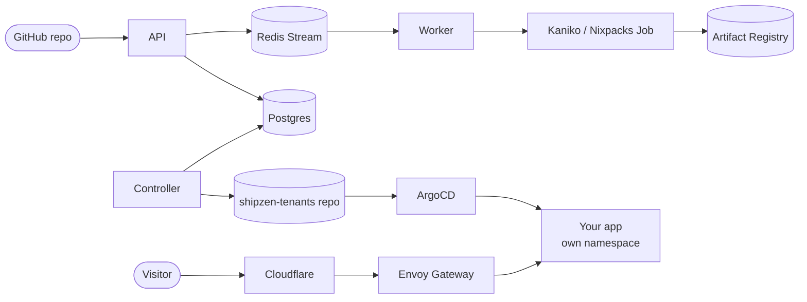

# ShipZen

A self-hosted, Heroku-style platform on Google Kubernetes Engine. Point it at a
GitHub repository and it builds a container, runs it in its own isolated
namespace, and gives it an HTTPS address, with live build logs, rollbacks,
per-app secrets and monitoring.

**Live:** https://shipzen.jeneeldumasia.codes (sign-in limited to an allowlist)



## What it does

- **Build anything**: a `Dockerfile` is built with Kaniko; without one, Nixpacks detects Node, Python, Go and more.
- **Isolated tenants**: one namespace per project with quotas, restricted Pod Security and its own RBAC.
- **GitOps**: the controller turns desired state in Postgres into manifests in Git, and ArgoCD applies them. Every change to a running app is a commit.
- **Reliable queue**: transactional outbox → Redis Streams consumer groups, with retries and a dead-letter queue.
- **No long-lived credentials**: Workload Identity Federation for CI, GKE Workload Identity for pods, a GitHub App for Git.
- **Readable monitoring**: Grafana dashboards anyone can understand, generated from code, plus logs per app.
- **Disposable infrastructure**: all Terraform; the cluster tears itself down after 24 h and rebuilds in about 20 minutes.

## Stack

| Layer | Technology |
|---|---|
| Services | FastAPI (API), Python (worker, controller), Next.js 16 + NextAuth (UI) |
| Runtime | GKE, Envoy Gateway (Gateway API), Cloudflare |
| Data | Cloud SQL Postgres, Redis Streams, GCS, Artifact Registry, Secret Manager |
| Delivery | GitHub Actions, Terraform + HCP Terraform, ArgoCD |
| Platform | External Secrets, Kyverno, ExternalDNS, KEDA, Velero |
| Observability | Prometheus, Grafana, Loki, Alertmanager |

## Documentation

| | |
|---|---|
| [Using ShipZen](docs/using-shipzen.md) | Deploying an app: repo layout, `PORT`, `shipzen.yaml`, env vars, rollback |
| [Architecture](docs/architecture.md) | Components, the deploy flow, data, tenancy, identities, repo map |
| [Security](docs/security.md) | Threat model, controls, how to verify them, known gaps |
| [Design decisions](docs/decisions.md) | Why it's built this way |
| [Setup](docs/operations/setup.md) | First-time setup of GCP, GitHub and HCP Terraform |
| [Runbook](docs/operations/runbook.md) | Workflows, common tasks, troubleshooting |
| [Monitoring](docs/operations/monitoring.md) | Dashboards, alerts, changing them |
| [DevBox](docs/operations/devbox.md) | Optional remote development VM |
| [Incidents](docs/operations/incidents.md) | Problems hit so far and their fixes |
| [Roadmap](docs/roadmap.md) | What's open |
| [History](docs/history.md) · [Pricing model](docs/business/pricing-model.md) | How it evolved; the business case |

## Development

```bash
pip install -r api/requirements.txt -r worker/requirements.txt -r controller/requirements.txt pytest pytest-asyncio
pytest                                   # Docker/Postgres-backed tests skip themselves when unavailable
docker compose -f docker-compose.local.yml up   # Postgres, Redis, API with local stub auth; no Kubernetes
```

Changes reach production through pull requests to `main`: images build and roll
out automatically, Kubernetes manifests sync through ArgoCD, and Terraform changes
are applied with the **Apply Infrastructure Changes** workflow.
