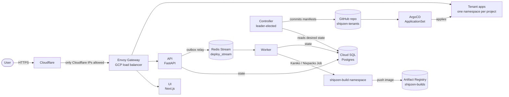
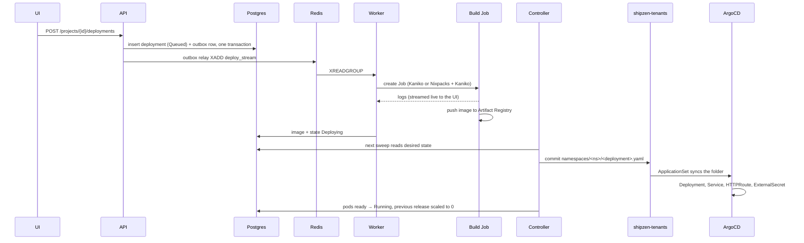

# Architecture

ShipZen is a small Heroku-style platform: you point it at a GitHub repository, it
builds a container image and runs it on GKE behind its own HTTPS URL. This page
describes how that works today. For *why* things are built this way, see
[decisions.md](decisions.md).

## The big picture

Postgres holds the **desired state** (projects, deployments, who can do what).
Everything else is derived from it: the worker turns a queued deployment into an
image, the controller turns desired state into Kubernetes manifests in Git, and
ArgoCD makes the cluster match Git.

## Components

| Component | Code | Runs as | Job |
|---|---|---|---|
| UI | `ui/` (Next.js 16, NextAuth v5, Tailwind) | `shipzen-ui` Deployment ×2 | GitHub login, project and deployment screens, live logs. Calls the API with the user's GitHub token. |
| API | `api/` (FastAPI) | `shipzen-api` Deployment ×2 | REST + WebSocket/SSE endpoints. Validates the GitHub token on every request, enforces project roles, writes to Postgres. Enqueues deploys through a transactional outbox. |
| Worker | `worker/` | `shipzen-worker` Deployment ×2 | Consumes `deploy_stream` with a consumer group. Clones the repo, starts a build Job, streams its logs, records the image, moves the deployment through its states. Retries, then dead-letters. |
| Builder | `worker/builder.py` | single-use Jobs in `shipzen-build` | Kaniko when the repo has a `Dockerfile`, otherwise Nixpacks generates one and Kaniko builds it. Pushes to `shipzen-builds`. |
| Controller | `controller/` | `shipzen-controller` Deployment ×2, one leader (Lease) | Every 60 s: renders each project's manifests from `controller/templates/`, commits changes to `shipzen-tenants`, marks deployments Running once their pods are ready, repairs drift, removes folders no project owns. |
| ArgoCD | Terraform `argocd.tf`, `infra/system/applicationset.yaml` | `argocd` namespace | `shipzen-platform` app syncs `infra/` (the platform itself); an ApplicationSet creates one app per `namespaces/<ns>/` folder in `shipzen-tenants`. Auto-sync, prune, self-heal. |
| Gateway | `infra/system/gateway.yaml` | Envoy Gateway in `envoy-gateway-system` | One GCP load balancer for every hostname. Its source ranges allow only Cloudflare. |

Supporting services: Redis (Bitnami chart, AOF on), Cloud SQL Postgres 15
(`db-f1-micro`), External Secrets Operator, Kyverno, KEDA, ExternalDNS
(Cloudflare), Velero, kube-prometheus-stack and Loki. See
[operations/monitoring.md](operations/monitoring.md) for the monitoring side.

## What happens when you deploy

Deployment states: `Queued → Building → Deploying → Verifying → Running`, with
`Retry`, `Failed` and the dead-letter queue for builds that keep failing. A
sweeper fails anything stuck in Queued/Building for over an hour.

Every deployment gets its own hostname:
`<first 8 chars of deployment id>-<project slug>-shipzen.jeneeldumasia.codes`.
ExternalDNS creates the Cloudflare record; Cloudflare terminates TLS for visitors
and talks to the gateway with an origin certificate.

**Rollback** redeploys the newest earlier Running release with a different image.
**Restart** rolls the Deployment's pods. **Cancel** stops a queued or building
deployment.

## Data

Postgres tables: `users`, `projects`, `project_members` (owner / editor / viewer),
`deployments`, `builds`, `audit_logs` (append-only), and `outbox_events`, which
the API relays to Redis so a deploy is never queued without being recorded (or
the reverse). The schema is applied by `infra/system/schema-job.yaml` from
`schema-configmap.yaml`.

Not in Postgres:

| Data | Where |
|---|---|
| App environment variables and secrets | Secret Manager, one secret per project (`shipzen-project-<project id>`, JSON). An ExternalSecret in the tenant namespace syncs it into the pods. |
| Build logs | GCS bucket `shipzen-build-logs-*` (live lines also go over Redis pub/sub to the UI) |
| Images | Artifact Registry: `shipzen-platform` for ShipZen itself, `shipzen-builds` for user apps |
| App runtime logs | Loki, shown on the Grafana "Your app" page |
| Tenant manifests | `jeneeldumasia/shipzen-tenants`, written by the controller through a GitHub App |

## Tenancy and isolation

Each project gets its own namespace, rendered from
`controller/templates/tenant.yaml.j2`:

- labels `shipzen.jeneeldumasia.codes/tenant=true` and the project id; Pod Security `restricted`
- `ResourceQuota tenant-quota` (4 CPU / 8 Gi requested, 20 pods) and a `LimitRange`
- a default service account with no token mounted
- a NetworkPolicy, enforced by GKE Dataplane V2: traffic in only from the Envoy
  gateway and its own pods; traffic out only to DNS, its own pods and the public
  internet. Never to other tenants, the platform, nodes, Cloud SQL or the metadata
  server. Build Jobs get the same treatment, and `shipzen-system` only accepts
  traffic from itself, the gateway and monitoring.
- RBAC limited to reading its own ConfigMaps

The controller re-renders `tenant.yaml` for existing projects about every 20
minutes, so template changes reach old projects too.

## Identities and permissions

Nothing uses long-lived keys. GitHub Actions authenticate to GCP through Workload
Identity Federation; pods use GKE Workload Identity.

| Google service account | Used by | Can do |
|---|---|---|
| `shipzen-platform-sa` | API, worker, controller | Manage Secret Manager secrets, write build logs, administer `shipzen-builds` |
| `shipzen-builder-sa` | build Jobs only | Push to `shipzen-builds`. Nothing else: builds run untrusted Dockerfiles. The **Security Check** workflow proves this. |
| `shipzen-eso-sa` | External Secrets Operator | Read secrets |
| `shipzen-node-sa` | GKE nodes | Logging, monitoring, image pulls |
| `velero-backup-sa` | Velero | Its backup bucket |

People: sign-in is GitHub OAuth, limited to `ALLOWED_GITHUB_USERS`; platform
admins come from `ADMIN_GITHUB_USERS` / `ADMIN_EMAILS`. Inside a project, owners
and editors can change things and viewers can read. More in
[security.md](security.md).

## Infrastructure

All of it is Terraform in `terraform/` (state in HCP Terraform, org
`jeneel-shipzen`, workspace `ShipZen-GCP`, local execution) and is applied by
GitHub Actions:

- VPC `shipzen-vpc` with Cloud NAT and private services access for Cloud SQL
- GKE `shipzen-cluster` (regional control plane in `us-central1`, nodes in `us-central1-c`, Dataplane V2), node pool `platform-nodes`: `e2-standard-4`, autoscaling 1–3
- Cloud SQL `shipzen-postgres` (private IP)
- Artifact Registry, GCS buckets, Secret Manager, service accounts and IAM
- Helm releases for every operator above, then ArgoCD, which takes over `infra/`

The cluster is disposable: **Auto-Destroy** tears it down after 24 hours of
uptime to protect credits, and the deploy workflow rebuilds it. Teardown also
deletes the disks the cluster leaves behind (`scripts/cleanup-orphaned-disks.sh`).
See [operations/runbook.md](operations/runbook.md).

## Repository map

| Path | What |
|---|---|
| `api/`, `worker/`, `controller/`, `ui/` | The four services, each with its own Dockerfile |
| `controller/templates/` | Jinja templates for tenant namespaces and app deployments |
| `infra/` | Kustomize tree ArgoCD syncs: platform Deployments, gateway, routes, dashboards, alerts |
| `terraform/` | The cluster and everything around it |
| `terraform-devbox/` | Optional remote dev VM ([operations/devbox.md](operations/devbox.md)) |
| `observability/dashboards.py` | Source of the Grafana dashboards |
| `scripts/` | CI helpers, disk cleanup, Windows setup helpers |
| `tests/` | Unit and regression tests (`pytest`) |
| `.github/workflows/` | Every operation: deploy, destroy, build, reports ([runbook](operations/runbook.md#workflows)) |
