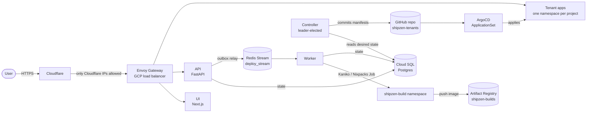

# Architecture

ShipZen is a small Heroku-style platform: you point it at a GitHub repository, it
builds a container image and runs it on GKE behind its own HTTPS URL. This page
describes how that works today. For *why* things are built this way, see
[decisions.md](decisions.md).

## The big picture



Postgres holds the **desired state** (projects, deployments, who can do what).
Everything else is derived from it: the worker turns a queued deployment into an
image, the controller turns desired state into Kubernetes manifests in Git, and
ArgoCD makes the cluster match Git.

## Components

| Component | Code | Runs as | Job |
|---|---|---|---|
| UI | `ui/` (Next.js 16, NextAuth v5, Tailwind) | `shipzen-ui` Deployment ×2 | GitHub login, project and deployment screens, live logs. Calls the API with the user's GitHub token. |
| API | `api/` (FastAPI) | `shipzen-api` Deployment ×2 | REST + WebSocket/SSE endpoints. Validates the GitHub token on every request, enforces project roles, writes to Postgres. Enqueues deploys through a transactional outbox. |
| Worker | `worker/` | `shipzen-worker` Deployment ×2 | Consumes `deploy_stream` with a consumer group. Clones the repo, records the commit, starts a build Job, streams its logs, records the image, moves the deployment through its states. On failure, explains the log (`worker/failure_rules.py`) and retries once with a fixed fix for known cases. Retries, then dead-letters. |
| Builder | `worker/builder.py` | single-use Jobs in `shipzen-build` | Kaniko when the repo has a `Dockerfile`, otherwise Nixpacks generates one and Kaniko builds it. Pushes to `shipzen-builds`. |
| Controller | `controller/` | `shipzen-controller` Deployment ×2, one leader (Lease) | Every 60 s: renders each project's manifests from `controller/templates/` (with the project's size and an HPA when it scales), commits changes to `shipzen-tenants`, marks deployments Running once their pods are ready, promotes production releases to live, announces previews (PR comment + email), sends deploy emails, repairs drift, removes folders no project owns. |
| ArgoCD | Terraform `argocd.tf`, `infra/system/applicationset.yaml` | `argocd` namespace | `shipzen-platform` app syncs `infra/` (the platform itself); an ApplicationSet creates one app per `namespaces/<ns>/` folder in `shipzen-tenants`. Auto-sync, prune, self-heal. |
| Gateway | `infra/system/gateway.yaml` | Envoy Gateway in `envoy-gateway-system` | One GCP load balancer for every hostname. Its source ranges allow only Cloudflare. |

Outside the cluster: **Resend** sends deploy emails from `notify@jeneeldumasia.codes`
(`shipzen_common/notify.py`, free tier), and the **GitHub App** delivers push and
pull-request webhooks and posts preview comments.

Supporting services: Redis (Bitnami chart, AOF on), Cloud SQL Postgres 15
(`db-f1-micro`), External Secrets Operator, Kyverno, KEDA, ExternalDNS
(Cloudflare), Velero, kube-prometheus-stack and Loki. See
[operations/monitoring.md](operations/monitoring.md) for the monitoring side.

## What happens when you deploy

```mermaid
sequenceDiagram
    participant U as UI
    participant A as API
    participant P as Postgres
    participant R as Redis
    participant W as Worker
    participant B as Build Job
    participant C as Controller
    participant G as shipzen-tenants
    participant K as ArgoCD
    U->>A: POST /projects/{id}/deployments (or a push / PR webhook)
    A->>P: insert deployment (Queued) + outbox row, one transaction
    A->>R: outbox relay XADD deploy_stream
    R->>W: XREADGROUP
    W->>W: sparse clone, record commit SHA / message / author
    W->>B: create Job (Kaniko or Nixpacks + Kaniko)
    B-->>W: logs (streamed live to the UI)
    B->>B: push image to Artifact Registry
    W->>P: image + state Deploying
    C->>P: next sweep reads desired state
    C->>G: commit namespaces/<ns>/<deployment>.yaml
    G->>K: ApplicationSet syncs the folder
    K->>K: Deployment, Service, HTTPRoute, ExternalSecret
    C->>P: pods ready → Running, made live; previous release scaled to 0 after the grace period
    C-->>U: email (and a PR comment for previews)
```

Deployment states: `Queued → Building → Deploying → Verifying → Running`, with
`Retry`, `Failed` and the dead-letter queue for builds that keep failing. A
sweeper fails anything stuck in Queued/Building for over an hour.

Every deployment gets its own hostname:
`<first 8 chars of deployment id>-<project slug>-shipzen.jeneeldumasia.codes`.
ExternalDNS creates the Cloudflare record; Cloudflare terminates TLS for visitors
and talks to the gateway with an origin certificate.

**Blue-green releases.** Each deploy is a new release (its own Deployment, Service
and route) next to the live one, and must pass its readiness checks before it's
marked Running. Then the controller makes it the project's live release
(`projects.live_deployment_id`): the stable vanity URL switches to it, and the
previous release keeps running for `RELEASE_GRACE_MINUTES` (10) before it's scaled
to 0. That means no gap while the route switches.

**Rollback:**
- **Within the grace period:** instant. The previous release is still running, so
  rollback just makes it live again.
- **After the grace period:** it redeploys the newest earlier Running release with
  a different image, without rebuilding.

**Restart** rolls the Deployment's pods. **Redeploy** builds the same branch again
with the same settings. **Cancel** stops a queued or building deployment. **Apply
now** (env vars) force-syncs the release's ExternalSecret and restarts the live
release. Releases beyond the newest `KEEP_RELEASES` (3) scaled-down ones become
`Superseded` and are cleaned up.

**Deployment kinds.** `deployments.kind` is `production` or `preview`:
- Previews come from pull requests on the bound repository; forks are ignored.
- A project has at most 3 PRs with previews, and each PR builds one commit at a time.
- Previews always run small × 1 and never become live, so every live-release
  query filters on `production`.
- Closing the PR marks its previews `Superseded`.

**Scaling.** A project has an instance size (small / medium / large, from
`shipzen_common/sizes.py`) and min/max instances. The live release gets those
requests and limits. When max > min it also gets an `autoscaling/v2` HPA at 70% CPU,
and the controller leaves its replica count to the HPA.

**Repo intelligence.** `POST /projects/analyze` (`api/analyzer.py`) downloads the
repository through the GitHub API and reports the services it finds:
- for each one, the build method, framework, package manager, runtime version,
  start command, port and health path;
- the reasons for each guess.

The chosen build folder is stored as `deployments.build_context`. Push deploys
copy it from the last production deploy.

**Platform operations** (admins, `api/routers/operations.py`):
- an announcement banner shown to every user;
- a deploy freeze, checked in `check_deploy_limits`, which every deploy path calls;
- user suspension;
- the session cost: node prices against the auto-destroy limits.

## Data

Postgres tables: `users` (with email preference and suspension), `projects` (with
vanity name, live release and scaling), `project_members` (owner / editor / viewer),
`deployments` (with commit, trigger, kind, PR number, build folder and build notes),
`builds`, `audit_logs` (append-only), `platform_settings` (announcement, deploy
freeze), and `outbox_events`, which
the API relays to Redis so a deploy is never queued without being recorded (or
the reverse). The schema lives in numbered migrations, `api/migrations/NNNN_*.sql`,
which the API applies at startup (`api/migrate.py`, recorded in `schema_migrations`,
serialised with an advisory lock). To change it, add the next numbered file; never
edit one that has been applied.

Not in Postgres:

| Data | Where |
|---|---|
| App environment variables and secrets | Secret Manager, one secret per project (`shipzen-project-<project id>`, JSON). An ExternalSecret in the tenant namespace syncs it into the pods. |
| Build logs | GCS bucket `shipzen-build-logs-*` (live lines also go over Redis pub/sub to the UI) |
| Images | Artifact Registry: `shipzen-platform` for ShipZen itself, `shipzen-builds` for user apps |
| App runtime logs and metrics | Loki and Prometheus; the API queries them for the app page (`api/observability_client.py`), and Grafana shows them to admins |
| Tenant manifests | `jeneeldumasia/shipzen-tenants`, written by the controller through a GitHub App |

## Tenancy and isolation

Each project gets its own namespace, rendered from
`controller/templates/tenant.yaml.j2`:

- labels `shipzen.jeneeldumasia.codes/tenant=true` and the project id; Pod Security `restricted`
- `ResourceQuota tenant-quota` (4 CPU / 8 Gi requested, 20 pods) and a `LimitRange`
- a default service account with no token mounted
- a NetworkPolicy, enforced by GKE Dataplane V2: traffic in only from the Envoy
  gateway and its own pods; traffic out only to DNS, its own pods and the public
  internet. Never to other tenants, the platform, nodes, Cloud SQL or the metadata
  server. Build Jobs get the same treatment, and `shipzen-system` only accepts
  traffic from itself, the gateway and monitoring.
- RBAC limited to reading its own ConfigMaps

The controller re-renders `tenant.yaml` for existing projects about every 20
minutes, so template changes reach old projects too.

## Identities and permissions

Nothing uses long-lived keys. GitHub Actions authenticate to GCP through Workload
Identity Federation; pods use GKE Workload Identity.

| Google service account | Used by | Can do |
|---|---|---|
| `shipzen-platform-sa` | API, worker, controller | Manage Secret Manager secrets, write build logs, administer `shipzen-builds` |
| `shipzen-builder-sa` | build Jobs, via a 1-hour token the worker mints per build (build pods have no identity of their own) | Push to `shipzen-staging`. Nothing else: builds run untrusted Dockerfiles. The worker copies each verified digest into `shipzen-builds`. |
| `shipzen-eso-sa` | External Secrets Operator | Read secrets |
| `shipzen-node-sa` | GKE nodes | Logging, monitoring, image pulls |
| `velero-backup-sa` | Velero | Its backup bucket |

People: sign-in is GitHub OAuth, limited to `ALLOWED_GITHUB_USERS`; platform
admins come from `ADMIN_GITHUB_USERS` / `ADMIN_EMAILS`. Inside a project, owners
and editors can change things and viewers can read. More in
[security.md](security.md).

## Infrastructure

All of it is Terraform in `terraform/` (state in HCP Terraform, org
`jeneel-shipzen`, workspace `ShipZen-GCP`, local execution) and is applied by
GitHub Actions:

- VPC `shipzen-vpc` with Cloud NAT and private services access for Cloud SQL
- GKE `shipzen-cluster` (zonal, in `us-central1-c`, so the control plane is in GKE's free tier; Dataplane V2) with three node pools:
  - `platform-nodes`: `e2-standard-4`, autoscaling 1–3, for ShipZen itself
  - `build-nodes`: Spot, gVisor, tainted, 0–2, for build Jobs only
  - `tenant-nodes`: `e2-standard-2`, gVisor, tainted, 0–3, for user apps only
- Cloud SQL `shipzen-postgres` (private IP)
- Artifact Registry, GCS buckets, Secret Manager, service accounts and IAM
- Helm releases for every operator above, then ArgoCD, which takes over `infra/`

The cluster is disposable: **Auto-Destroy** tears it down once it is 9 hours old and
nobody has used it for an hour (12 hours at the latest), or run **Infra Teardown**
when you're done; **Deploy Platform Infra**, which only ever runs by hand, rebuilds it.
Teardown also deletes the disks the cluster leaves behind
(`scripts/cleanup-orphaned-disks.sh`) and Cloud SQL itself, after exporting it to
GCS (`scripts/db-snapshot.sh`); the deploy workflow restores that export before the
services start. A torn-down platform costs nothing.
See [operations/runbook.md](operations/runbook.md).

## Repository map

| Path | What |
|---|---|
| `api/`, `worker/`, `controller/`, `ui/` | The four services, each with its own Dockerfile |
| `api/routers/` | API endpoints, one module per area (projects, deployments, env, webhooks, admin, operations, observability, audit, github); `api/main.py` only assembles the app |
| `shipzen_common/` | Code shared by the services: instance sizes, `shipzen.yaml` rules, GitHub App tokens and PR comments, email notifications, redaction |
| `controller/templates/` | Jinja templates for tenant namespaces and app deployments |
| `infra/` | Kustomize tree ArgoCD syncs: platform Deployments, gateway, routes, dashboards, alerts |
| `terraform/` | The cluster and everything around it |
| `terraform-devbox/` | Optional remote dev VM ([operations/devbox.md](operations/devbox.md)) |
| `observability/dashboards.py` | Source of the Grafana dashboards |
| `scripts/` | CI helpers, disk cleanup, Windows setup helpers |
| `tests/` | Unit and regression tests (`pytest`) |
| `.github/workflows/` | Every operation: deploy, destroy, build, reports ([runbook](operations/runbook.md#workflows)) |

### API code layout

`api/main.py` builds the FastAPI app (middleware, lifespan, `/metrics`,
`/healthz`) and includes one router per area from `api/routers/`. Shared pieces:

| Module | Holds |
|---|---|
| `database.py` | Connection pool and the permission checks every router uses: `verify_project_access`, `verify_project_write_access`, `assert_project_owner` |
| `auth.py` | GitHub-token sign-in, allowlist, admin rules, suspension |
| `platform_clients.py` | Redis, Secret Manager, GCS and Kubernetes clients, created once per process |
| `secret_store.py` | Per-project env vars and secrets (one Secret Manager secret behind both `/env` and `/secrets`) |
| `helpers.py` | Image naming, deploy limits (freeze, suspended owner, quotas), queuing a deploy through the outbox |
| `analyzer.py` | Repository analysis behind **Analyze** |
| `observability_client.py` | Loki and Prometheus queries for the app page's logs and metrics |
| `background.py` | Outbox relay and cache-eviction listener |
| `ratelimit.py`, `validation.py` | Rate limiter; input rules shared by request models |

`tests/test_api_contract.py` checks every endpoint over HTTP, so internal moves
can be verified against it.
