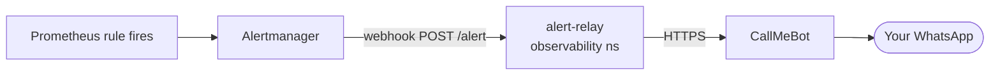

# Monitoring

Grafana at https://grafana-shipzen.jeneeldumasia.codes opens on **ShipZen —
Overview**. The dashboards are written for people who don't run Kubernetes: plain
titles, green or red instead of raw numbers, and an (i) on every panel saying
what it means.

## Dashboards

| Dashboard | Folder | Answers |
|---|---|---|
| **ShipZen — Overview** (home) | ShipZen | Is every part of ShipZen working? What's wrong right now? How many apps are online, did deploys succeed, is there room for more? |
| **ShipZen — Your app** | ShipZen | For one project: online or not, visitors, failed requests, response time, crashes, CPU and memory against its limits, and its logs with a search box. |
| **ShipZen — Deploys & builds** | ShipZen | Success rate, typical and slowest build time, waiting time, the queue, retries. |
| **ShipZen — Platform internals** | ShipZen (technical) | API requests, errors and latency by route; gateway traffic by namespace; reconcile time and drift; cluster CPU, memory, disks; scrape targets that are down. |

The chart's stock Kubernetes dashboards are turned off
(`grafana.defaultDashboardsEnabled=false` in `terraform/monitoring.tf`).

## Where the numbers come from

| Data | Source |
|---|---|
| Is a service up, crashes, CPU and memory | kube-state-metrics and cAdvisor (kube-prometheus-stack) |
| Visitors, errors, response time per app | Envoy proxy stats (`infra/system/gateway-metrics.yaml`). Only `envoy_cluster_upstream_rq_*` is kept. |
| Deploys, builds, queue | `shipzen_*` metrics from the worker and controller |
| API traffic | `shipzen_api_*` from the API's `/metrics` |
| Database up | `shipzen_database_up`, set by the controller from a `SELECT 1` every 30 s |
| App logs | Loki (Promtail ships every pod's stdout), Grafana datasource "Logs" |

Tenant namespaces are recognised by their `tenant-quota` ResourceQuota, and Envoy
stats are mapped to a namespace through the route name
(`httproute/<namespace>/...`).

## Alerts

Rules live in `infra/system/shipzen-alerts.yaml`:

| Alert | Fires when |
|---|---|
| ShipZenServiceDown | ui, api, worker or controller has no ready pods for 3 min |
| GatewayDown | the Envoy proxy has no ready pods for 2 min |
| DeployQueueDown | Redis isn't ready for 2 min |
| DatabaseUnreachable | the controller can't query Postgres for 2 min |
| DeploysStuckInQueue | more than 10 deploys waiting for 10 min |
| DeploysGaveUp | anything in the dead-letter queue for 5 min |
| ServersAlmostFull | over 90% of CPU or memory booked for 15 min |
| AppOffline | an app that should run has no ready pods for 10 min |
| AppKeepsCrashing | an app restarted more than 3 times in 15 min |
| AppErrorsHigh | over 5% of an app's requests fail with 5xx for 10 min |

Firing alerts appear in **Problems right now** on the Overview, translated into
plain words, and go to **WhatsApp**:



Alertmanager groups alerts by name and namespace, waits 1 minute before the
first message, sends updates at most every 5 minutes, repeats an unresolved
problem every 12 hours, and sends a ✅ message when it clears. Only `warning`,
`high` and `critical` are sent. The relay (`infra/system/alert-relay/relay.py`)
uses the same plain words as Grafana. It is only ever called by that webhook;
nothing polls. Setup steps are in the [runbook](runbook.md#common-tasks).

Scheduler, controller-manager, etcd and kube-proxy scraping is disabled, because
GKE manages those and they would raise permanent false alarms.

## Changing dashboards

Dashboards are code. Edit `observability/dashboards.py`, then:

```bash
python observability/dashboards.py   # regenerates infra/system/grafana-dashboards.yaml
pytest tests/test_regressions.py     # fails if the two are out of sync, or a query
                                     # uses a metric nothing exports
```

Commit both files; ArgoCD applies the ConfigMaps and Grafana reloads them. Edits
made in the Grafana UI are lost on the next sync.

When you add an alert, also add its plain-language text to `PROBLEM_TEXT` in
`dashboards.py`. A test checks this.
